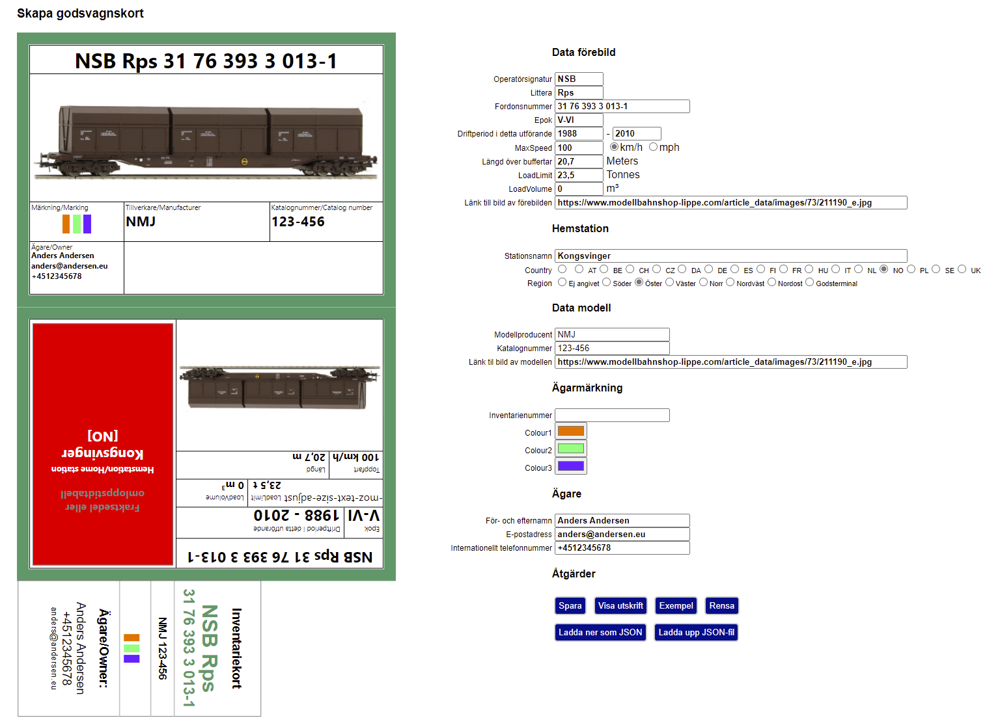

# Loco and Wagon Card App
This app helps the *module model railwayers* to 
create *wagon*- and *loco* cards and preview them for printing. 
The loco/wagon cards are primarily intended for simpler or modern scenarios.
Recent updates to the app are described in the [release notes](https://github.com/tellurianinteractive/Tellurian.Trains.WagonCardApp/blob/master/RELEASENOTES.MD).

**Open the app:** [wagoncardapp.azurewebsites.net](https://wagoncardapp.azurewebsites.net)

## Background
I wanted to create a loco- and wagon-card app that is easy to read and with high grapical standard.
These cards will only contain essential details that are of common interest or are necessary for operation at an average meeting.

#### Language support
The app supports English, German, Danish, Norwegian and Swedish. 
The language is controlled by preferred language settings in your browser.

#### Install and use offline
The app can be installed on phones, tablets and computers, using the browser's *install* or *add to home screen* option.
Once opened, it also works without an internet connection.

#### Your data stays in your browser
The cards you create, and your owner details, are only saved in your own browser.
Nothing is sent to or stored on a server.
This also means that the data is not shared between browsers or devices.
Use *Download as JSON* to keep a copy, or to move a card to another device.

Browsers can clear saved data, for example in private windows, when you clear browsing data,
or, in Safari on iPhone and iPad, after 7 days without a visit.
Installing the app to the home screen avoids the Safari limit.

#### Contribute
**Thanks for all user feedback!**
The app is *open source* and developed in 
[Blazor](https://dotnet.microsoft.com/en-us/apps/aspnet/web-apps/blazor) and 
[.NET](https://dotnet.microsoft.com/en-us/learn/dotnet/what-is-dotnet), using a free version of
[Visual Studio](https://visualstudio.microsoft.com/).
If you have a GitHub account, you can file [suggestions and other issues](https://github.com/tellurianinteractive/Tellurian.Trains.WagonCardApp/issues).
Discussions are also in the [FREMO forum](https://forum.fremo-net.eu/t/online-loco-and-wagon-card-app/).

## Features
#### Freigh Wagon Card
The coloured frame adapts according the FREMO standard based on the vehicle class.
You also get an *inventory card*, see below.

#### Passenger Wagon Card
Coloured frame according the FREMO standard.
You also get an *inventory card*, see below.

#### Loco Card
I addition to the loco-card itself, you get a *FRED-stcker* and an *inventory card*. 
The loco functions are printed both on the loco card itself 
and selected ones on the FRED-sticker.

#### FRED Label
The FRED label contains maximum 8 functions, you can select which.
The top can be folded so that the locomotive identification is visible above the front,

#### Inventory Cards
The idea with an inventory card is that you remove it from the loco/wagon-card pocket 
when you place the loco/wagon on a track.
You put the inventory card on the loco/wagon box.
Then you know that you should collect before travelling home after the meeting.

#### QR Codes
QR codes are visible on both loco- and wagon cards. 
QR-code also on FRED-sticker. QR-code contains *loco address*, *owner's name*, *UIC-number*, and *label*.
If a value is not provided, it won't show up in the QR-code.
The content of the QR-code is formatted as JSON, which also makes it machine readable.

#### Example of Freight Wagon Card


## Development and hosting
The app is a [Blazor WebAssembly](https://learn.microsoft.com/aspnet/core/blazor/hosting-models#blazor-webassembly) app
that runs entirely in the browser.
It has no server part: once published, it is a set of static files that any web server can host.

#### Projects
| Project | Content |
|---|---|
| `src/Client` | The app: pages, components, and `wwwroot` with the static files. |
| `src/Shared` | The data model for locos, wagons and owners, and helpers. |
| `WagonCardApp.Shared.Tests` | Unit tests. |

The text pages (*Home*, *About* and *References*) are markdown files in `src/Client/wwwroot/content`,
named `{page}.{language}.md`, for example `Index.sv.md`, with `{page}.md` as the English fallback.

#### Run and test
Requires the [.NET 11 SDK](https://dotnet.microsoft.com/download).
In Visual Studio, start the `WagonCardApp.Client` project, or from the command line:
```
dotnet run --project src/Client
dotnet test
```
Offline support is only active in the published app. During development, the service worker does nothing, so changes show up directly.

#### Publish
```
dotnet publish src/Client -c Release -o publish
```
The `publish` folder then contains `web.config` and a `wwwroot` folder with the app.

#### Hosting on IIS or Azure App Service
The app is hosted as static files on a Windows Azure App Service, and the same works on any IIS server.
No .NET runtime is needed on the server.
Deploy the whole `publish` folder; the `web.config` in `src/Client` configures IIS to
- serve the files from `wwwroot`,
- serve the file types IIS does not know by default, such as `.wasm`, `.dat` and `.md`,
- return `index.html` for app addresses like `/cargowagon`, so links and page reloads work.

This requires the IIS *URL Rewrite* module, which is installed on Azure App Service.
The project sets `PublishIISAssets` to `true`; without it, publishing drops the custom `web.config`.

#### Hosting elsewhere
Other static hosts, such as Azure Static Web Apps, GitHub Pages or Netlify, can serve the `publish/wwwroot` folder.
They need the same two settings in their own configuration format:
markdown files served as `text/markdown`, and `index.html` returned for addresses that are not files.

Note that browsers keep saved data per web address.
If the app moves to a new address, users lose their saved cards and owner details, unless they download them as JSON first and upload them in the new location.
